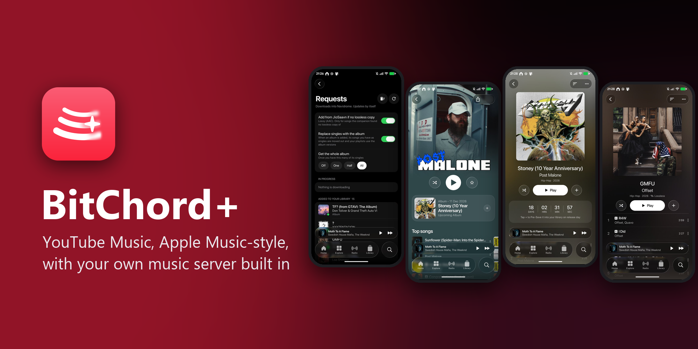
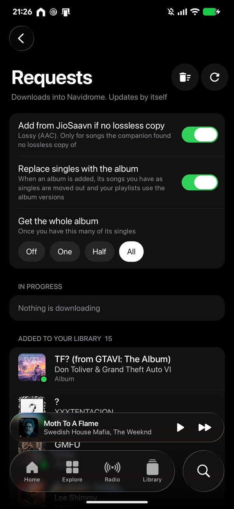
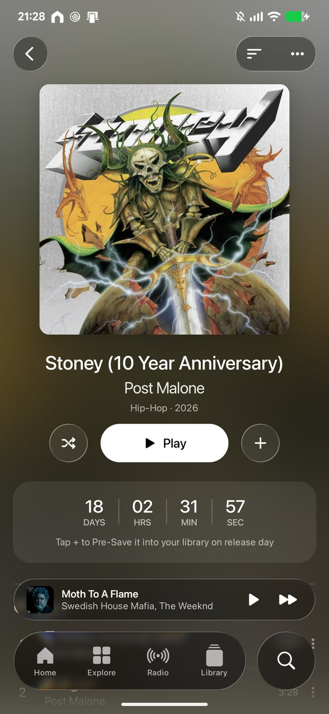
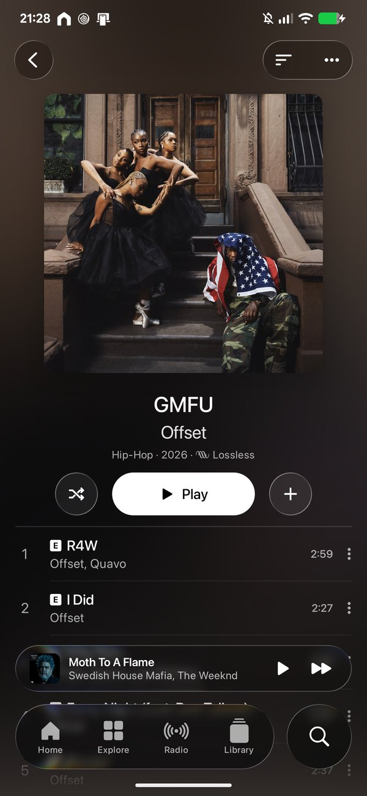
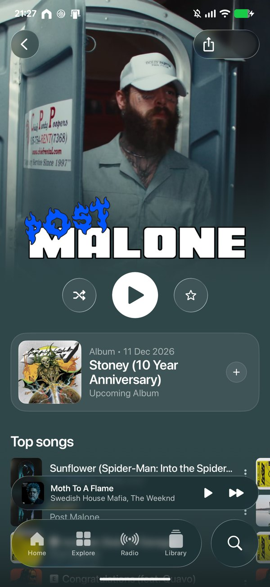
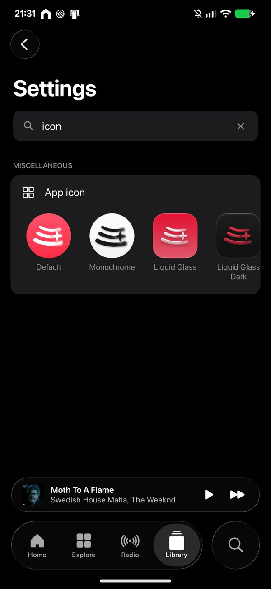

 
 

# BitChord+

### YouTube Music, Apple Music-style, with your own music server built in

 

 

[**Download**](#download) · [**What's new**](#whats-new) · [**Companion**](#companion) · [**Features**](#features) · [**Original BitChord**](#original-bitchord) · [**Disclaimer**](#disclaimer)

> [!IMPORTANT]
> BitChord+ is not affiliated with, endorsed by, or connected to YouTube or Google in any way. Use it at your own discretion.

---

<h1>What's new in BitChord+</h1>

Everything [BitChord](https://github.com/kushagrasinghx/BitChord) does, plus your own music server as a first-class part of the app.

 

<table>
  <tr>
    <td width="33%" align="center" valign="top">
        
      <b>Requests</b> 
      Ask for any song or album and it lands in your library, lossless only. Artwork, status, retry, swipe to delete with undo, and the companion's settings in one place.
    </td>
    <td width="33%" align="center" valign="top">
        
      <b>Pre-Save</b> 
      Upcoming albums with a live countdown. Pre-Save one and it is downloaded on release day; songs already out play right away.
    </td>
    <td width="33%" align="center" valign="top">
        
      <b>Apple Music-style pages</b> 
      Genre, year and the real quality your server has (Lossless, Hi-Res Lossless), disc sections and full-screen covers. Your server plays up to 24-bit FLAC next to YouTube Music.
    </td>
  </tr>
  <tr>
    <td width="33%" align="center" valign="top">
        
      <b>What's next, on every artist</b> 
      An announced album takes the release card, with a one-tap Pre-Save. Otherwise it shows the newest release of any kind, dated to the day.
    </td>
    <td width="33%" align="center" valign="top">
        
      <b>Its own look</b> 
      A new icon in glass, clear and neon styles for Samsung and Pixel launchers, a glass tab bar and size options.
    </td>
    <td width="33%" valign="top">

#### Also new
- **Upcoming** on Home, under Top Picks.
- **Playlist sync** to your server, with missing songs requested automatically.
- **Singles to albums**: replace singles when the album arrives, playlists included.
- **Listen Together** on your own companion.

    </td>
  </tr>
</table>

---

<h1>BitChord+ Companion</h1>

Requests, Pre-Save, playlist sync and Listen Together parties run on a small service next to your Navidrome: **[BitChord+ Companion](https://github.com/ILostXD/BitChord_Plus_Companion)**. Set it up there, then add its address under **Sources → your Navidrome**. Only the source with a companion address is used for requests, so any other servers you add stay plain sources.

- **Lossless only.** It searches Soulseek (and Qobuz, if set up) several ways: by album artist, inside the album a song is from, by the album named in "(from …)", and spells out titles like "?" that can't be folder names. If nothing lossless exists, you can let the app add JioSaavn's copy instead; that is off unless you switch it on.
- **Knows your library.** Before downloading, it checks what you already have: another edition, a different credit line, the same album under an artist's other name (Kanye West / Ye). When it is unsure, it asks.
- **Singles to albums.** Optionally, when an album arrives, its songs you have as singles are moved aside and your playlists point at the album versions. It can also ask for an album once you have one, half or all of its singles.
- **Listen Together.** The companion runs BitChord's party server, and the app uses it automatically.

---

<h1>Download</h1>

Grab the latest signed APK from [Releases](https://github.com/ILostXD/BitChord_Plus/releases). Most phones want **arm64-v8a**; *universal* runs anywhere. Sideloading needs "Install unknown apps" for the app you download it with.

BitChord+ has its own package name, so it installs **beside** the original BitChord instead of replacing it, and updates itself from this repository. Every release says which BitChord version it is based on.

---

<h1>Features</h1>

<table>
  <tr>
    <td width="50%" valign="top">

#### Playback
- **Search, browse and play** anything available on YouTube Music.
- **Hi-Res lossless audio** from your server or a module source, with YouTube Music as fallback.
- **Gapless playback with true crossfade**, adjustable 0–12s.
- **Automix [Beta]**: DJ-style transitions with beat-matching and tempo-stretching.
- **Offline downloads** with embedded metadata.
- **Local music library** integration.
- **Apple-like lyrics animation**, credit to [binimum](https://github.com/binimum/am-lyrics).

#### Your library
- **Navidrome and Subsonic servers** as a source, with their library, playlists and favourites in the app.
- **Import Playlist** from your server or Spotify into YouTube Music.
- **Requests, Pre-Save and playlist sync** through the companion.

#### Connectivity & Accounts
- **Sign in with your Google account** for personalized content.
- **Spotify integration**: your playlists and Liked Songs.
- **Discord Rich Presence** and **scrobbling** to Last.fm and ListenBrainz.
- **Listen Together**: share a code and play the same music, in time.

    </td>
    <td width="50%" valign="top">

#### Experience
- **Animated album canvas**: motion artwork on the now-playing screen.
- **Word-synced lyrics** from many providers (full credits in the [original README](https://github.com/kushagrasinghx/BitChord#features)).
- **Dynamic, artwork-driven theming** and a **frosted-glass UI**.
- **Album page backgrounds**: blurred, Apple Music or classic.
- **Navigation options**: tab bar and mini player sizes, Search in the bar or on its own.
- **Replay Year**, Google Drive backup, Radio, Best Part and more from BitChord.

#### Controls & Tweaks
- **Per-network audio quality** for Wi-Fi and mobile data.
- **Playback speed** (0.5×–2.0×) and **skip silence**.
- **Sleep timer**: presets or "stop after this track".
- **System equalizer** integration.
- **Bit-perfect USB exclusive output** to a USB DAC.
- **Stats for nerds** and a live **Audio Pipeline** view: source, codec, bit depth, sample rate.

    </td>
  </tr>
</table>

---

<h1>Original BitChord</h1>

BitChord+ stands on **[BitChord](https://github.com/kushagrasinghx/BitChord)** by Kushagra Singh. Everything it does that isn't listed above is their work: thank you to Kushagra and every BitChord contributor. Each BitChord release is merged into BitChord+, and the app shows in Settings which one it is based on and whether a newer one is out. If you don't need the server features, use the original: [BitChord releases](https://github.com/kushagrasinghx/BitChord/releases).

The Automix model is downloaded from the original BitChord's releases the first time you turn Automix on. Credit for the lyrics, Automix and USB DAC work is in the original README.

---

<h1>Disclaimer</h1>

BitChord+ is an independent, community-driven third-party audio player and client. It is **not** associated with Google LLC, YouTube Music, or any of their parent companies.

* **No media hosting:** BitChord+ does not host, upload, or store copyrighted music files. It is an interface to local storage, public or user-authenticated APIs, and servers you run yourself.
* **Your server, your files:** the companion downloads only what you ask it to, into your own library. You are responsible for making sure that is allowed where you live.
* **Fair use:** this software is made for personal, educational and fair-use purposes. You are responsible for using it in line with your local copyright laws and YouTube's Terms of Service.
* **Copyleft:** BitChord+ is free software under the GPLv3, like BitChord. Any distribution must come with the Corresponding Source under the same license.

## License

Licensed under the **GNU General Public License v3.0 (GPLv3)**. See [LICENSE](LICENSE).
