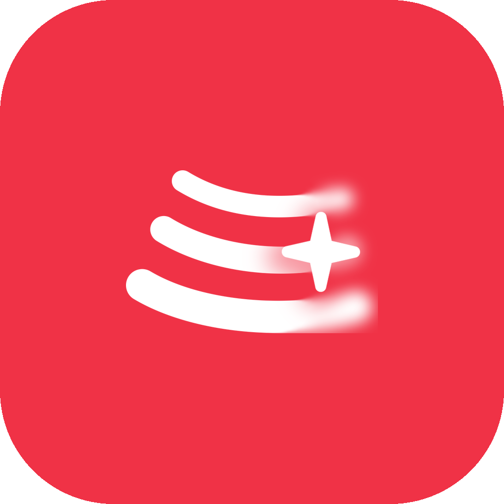

 
 

# BitChord+

### An Apple Music-style YouTube Music client with your own music server built in

 

 

[**Download**](#download) · [**What's different**](#whats-different-from-bitchord) · [**Features**](#features) · [**Original BitChord**](#original-bitchord) · [**Disclaimer**](#disclaimer)

> [!IMPORTANT]
> BitChord+ is not affiliated with, endorsed by, or connected to YouTube or Google in any way. Use it at your own discretion.

---

## What's different from BitChord

BitChord+ is a fork of [BitChord](https://github.com/kushagrasinghx/BitChord) by Kushagra Singh. It keeps everything BitChord does and merges each BitChord release (the app shows which one it is based on in Settings), and adds:

- **Navidrome, Jellyfin and other Subsonic servers as a source**, with *Import Playlist*: pick a playlist from your server and it becomes a YouTube Music playlist.
- **Companion downloads** through [Glaze Companion](https://github.com/ILostXD/GlazeCompanion) (slskd, and Qobuz if you set it up): *Request for Navidrome* in every song's menu, and per-playlist *Sync to Navidrome*. Lossless is always preferred.
- **Library-aware matching.** Before anything is downloaded, the companion checks what you already own: another edition (deluxe vs. standard), a different credit line, the same song on another album. Anything it is unsure about asks you first, in the app and on a dashboard.
- **Pre-Save.** Upcoming albums from the artists in your library get an *Upcoming* shelf on Home with a countdown. Tracks that are already out can be played from YouTube Music, and are downloaded into your library while you wait for the rest.
- **Apple Music-style album pages**: disc sections, blurred, Apple Music or classic page backgrounds, full-screen album covers.
- **Navigation bar options**: mini player and tab bar sizes, and Search either inside the bar or as its own circle.
- **Its own app, its own updates.** BitChord+ installs next to BitChord and updates from this repository's releases.

## Download

Grab the latest APK from the [Releases](https://github.com/ILostXD/BitChord_Plus/releases) page. Sideloading requires enabling "Install unknown apps" for whichever app you download it with. BitChord+ uses its own package name, so it installs beside the original BitChord instead of replacing it.

Each release says which BitChord version it is based on.

---

<h1>Features</h1>

<table>
  <tr>
    <td width="50%" valign="top">

#### Playback
- **Search, browse and play** anything available on YouTube Music.
- **Hi-Res lossless audio** — FLAC/ALAC from a configured module source, with YouTube Music as fallback.
- **Gapless playback with true crossfade**, adjustable 0–12s.
- **Automix [Beta]** — DJ-style transitions with beat-matching and tempo-stretching.
- **Offline downloads** — save tracks with embedded metadata.
- **Local music library** integration.
- **Background playback** via a proper foreground media session.
- **Apple-like lyrics animation** — credit to [binimum](https://github.com/binimum/am-lyrics).

#### Connectivity & Accounts
- **Sign in with your Google account** for personalized content.
- **Spotify integration** — connect your account to play your playlists and Liked Songs.
- **Navidrome / Subsonic source** — play from your own server, import its playlists.
- **Discord Rich Presence** — in-app login, live track/artist/album and progress.
- **Scrobbling** to Last.fm and ListenBrainz.
- **Pluggable sources** — add, edit, test and health-check module sources.

    </td>
    <td width="50%" valign="top">

#### Experience
- **Animated album canvas** — motion artwork on the now-playing screen.
- **Word-synced lyrics** — word/syllable-level highlighting from multiple sources.
- **Dynamic, artwork-driven theming** — Material palette extracted from album art.
- **Frosted-glass UI** — translucent bars via Haze, Material 3 theming.
- **Replay Year**, Google Drive backup, Radio, Best Part and more from BitChord.

#### Controls & Tweaks
- **Per-network audio quality** — separate quality ceilings for Wi-Fi and mobile data.
- **Playback speed control** (0.5×–2.0×) and **skip silence**.
- **Sleep timer** — fixed presets or "stop after this track".
- **System equalizer** integration.
- **Bit-perfect USB exclusive output** to a USB DAC.
- **Stats for nerds** — codec, bit depth, sample rate, and more on the now-playing screen.

    </td>
  </tr>
</table>

---

## Original BitChord

BitChord+ stands on [BitChord](https://github.com/kushagrasinghx/BitChord). Everything it does that is not listed above is their work: thank you to Kushagra Singh and every BitChord contributor. If you want the app without the Navidrome features, use the original: [releases](https://github.com/kushagrasinghx/BitChord/releases). Credit for the lyrics, Automix and USB DAC work is in the original README.

The Automix model is downloaded from the original BitChord's releases the first time you turn Automix on.

## Disclaimer

BitChord+ is an independent, community-driven third-party audio player and client. It is **not** associated with Google LLC, YouTube Music, or any of their parent companies.

* **No media hosting:** BitChord+ does not host, upload, or store copyrighted music files. It operates strictly as an interface to scan local device storage, stream media from public or user-authenticated APIs, or play from servers you run yourself.
* **Your server, your files:** the companion downloads only what you ask it to, into your own library. You are responsible for making sure that is allowed where you live.
* **Fair use:** this software is created for personal, educational and fair-use purposes. You are responsible for ensuring your usage aligns with your local copyright laws and YouTube's Terms of Service.
* **Copyleft:** BitChord+ is free software under the GPLv3, like BitChord. Any distribution must come with the Corresponding Source under the same license.

## License

Licensed under the **GNU General Public License v3.0 (GPLv3)**. See [LICENSE](LICENSE).
